# WRF Configuration Studio Website User Guide

Version: **v1.0.0**  
Guide scope: **online hosted use and local package use**  
Prepared for: **WRF Configuration Studio website and GitHub documentation**

WRF Configuration Studio is a browser-based configuration environment for WRF domain design, `namelist.wps` editing, `namelist.input` editing, WRFDA group review, OBSPROC export, and Registry metadata exploration. The application is designed to help users organize WRF configuration work before running the official WRF, WPS, WRFDA, and OBSPROC programs.

This guide covers both supported ways to use the website build:

- **Online hosted mode**, where the app is opened from a hosted website or GitHub Pages address.
- **Local package mode**, where the release package is extracted and served from the user's computer with a local HTTP server.

> **Important map note:** WRF Configuration Studio v1.0.0 uses online map tiles only. The bundled offline vector-map fallback is not included. Local package mode can run the app files from the user's computer, but the map background still requires network access to online tile providers.

---

## Current feature checkpoint

This package includes 184 valid compatibility rules, WRFDA and OBSPROC workflow presets, collapsed-group issue highlighting, click-to-jump issue navigation, natural numeric WRFVAR group sorting, and separate `namelist.obsproc` export.

---

## 1. What WRF Configuration Studio Does

WRF Configuration Studio helps users prepare and review WRF-family configuration files through one browser-based workspace.

It supports:

- interactive WRF domain creation and editing,
- `namelist.wps` workflow support,
- a full-catalog `namelist.input` editor,
- WRFDA groups inside `namelist.input`,
- OBSPROC records exported separately as `namelist.obsproc`,
- Registry metadata and documentation review,
- ARW Technical Note v4 scientific context, where available,
- required-field warnings before export,
- suggested starting values for selected timing and projection fields,
- 360-degree map wrapping and repeated-world display behavior,
- desktop touch-screen and trackpad support, and
- desktop browser support for Chrome, Edge, Firefox, and Safari.

The tool does **not** run `geogrid.exe`, `ungrib.exe`, `metgrid.exe`, `real.exe`, `wrf.exe`, `obsproc.exe`, or WRFDA executables. It prepares configuration files for review before the official tools are run.

---

## 2. Online Hosted Mode

Online hosted mode is the simplest way to use the app when the project is published through a website or GitHub Pages.

### Steps

1. Open the public WRF Configuration Studio website address.
2. Wait for the map and side panels to load.
3. Open the **Domains** panel.
4. Create or edit the WRF domain.
5. Open the `namelist.input` editor if model namelist work is needed.
6. Save or copy the generated files.

### What works online

In hosted mode, the browser loads the app from the website. Map tiles are also loaded online. This mode is best for training, demonstrations, classroom use, and quick review when a network connection is available.

### Browser cache after website updates

After a new website build is published, browsers can keep older JavaScript, CSS, or JSON files in cache. Use a hard refresh after updates.

Common hard-refresh shortcuts:

```text
Windows/Linux Chrome, Edge, Firefox: Ctrl+F5
macOS Chrome/Firefox: Cmd+Shift+R
macOS Safari: Option+Cmd+E, then reload
```

---

## 3. Local Package Mode

Local package mode is the recommended method when using the downloaded release package.

### Steps

1. Download the WRF Configuration Studio release package.
2. Extract the package to a normal folder.
3. Start a local HTTP server from inside the extracted folder.
4. Open the local address printed by the launcher.
5. Use the application normally in the browser.

### Use the included launchers

The package includes helper launchers:

```text
launch-local.bat
launch-local.sh
launch-local.command
launch_local_server.py
```

On Windows, use:

```text
launch-local.bat
```

On macOS or Linux, use:

```text
launch-local.sh
```

or:

```text
launch-local.command
```

The launcher starts on port `8000` when available. If that port is already in use, the launcher uses the next available port and prints the correct local URL.

Example:

```text
Port 8000 is already in use. Using port 8001 instead.
Open: http://127.0.0.1:8001/
```

### Use Python directly

From the extracted folder, run:

```bash
python -m http.server 8000
```

Then open:

```text
http://127.0.0.1:8000
```

### Local package mode versus offline map mode

Local package mode means the app files, runtime catalogs, documentation, examples, and source references can be served from the user's computer. It does **not** mean that the map background is fully offline. In v1.0.0, the map uses online tile providers only. If network access is unavailable, the map background may not render until the connection or tile provider becomes available.

---

## 4. Main Interface and Domain Intelligence

The **Domains** panel is the main starting point. It contains the New, Open, and `namelist.input` buttons, plus the Domain Intelligence tools used to help configure projection and grid behavior.

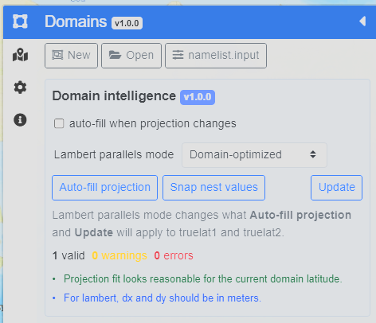

**Figure 1. Domain Intelligence panel in the Domains sidebar.** The panel shows the Lambert parallels mode selector, Auto-fill projection, Snap nest values, Update, validation messages, and projection notes.

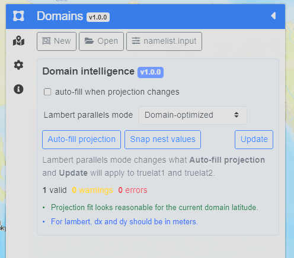

**Figure 2. Domain Intelligence panel shown in the full sidebar context.** The sidebar keeps the domain controls close to the map workspace so the user can review projection guidance while editing the domain.

The Domain Intelligence panel is designed as a helper, not an enforcement system. It can suggest projection values and report obvious configuration messages, but users remain responsible for reviewing the exported namelists and running the official WRF tools.

---

## 5. Lambert Parallels Mode

For Lambert conformal domains, the Lambert parallels mode selector controls how `truelat1` and `truelat2` are suggested when Auto-fill projection or Update is used.

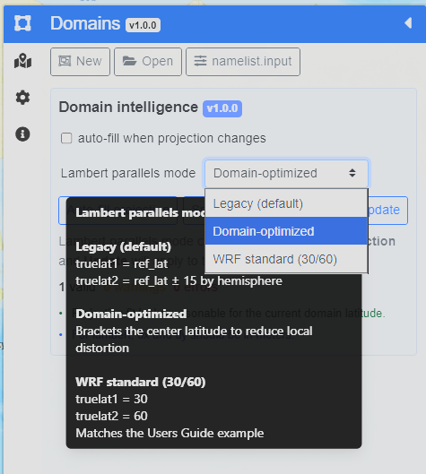

**Figure 3. Lambert parallels mode selector and help text.** The selector includes Legacy, Domain-optimized, and WRF standard 30/60 options. The tooltip explains how each mode affects `truelat1` and `truelat2`.

The modes are:

- **Legacy (default):** uses the older behavior, with `truelat1 = ref_lat` and `truelat2 = ref_lat +/- 15` by hemisphere.
- **Domain-optimized:** brackets the center latitude to reduce local distortion.
- **WRF standard (30/60):** uses `truelat1 = 30` and `truelat2 = 60`, matching a common WRF Users Guide example.

Press **Update** after changing the mode so the selected behavior is applied to the current domain.

---

## 6. Creating and Editing Domains

To create a domain:

1. Open the **Domains** panel.
2. Select the projection type.
3. Press **New**.
4. Draw the domain on the map.
5. Move or resize the domain with the handles.
6. Review the WPS fields in the sidebar.
7. Press **Update** when changes need to be applied.
8. Save `namelist.wps` when the WPS configuration is ready.

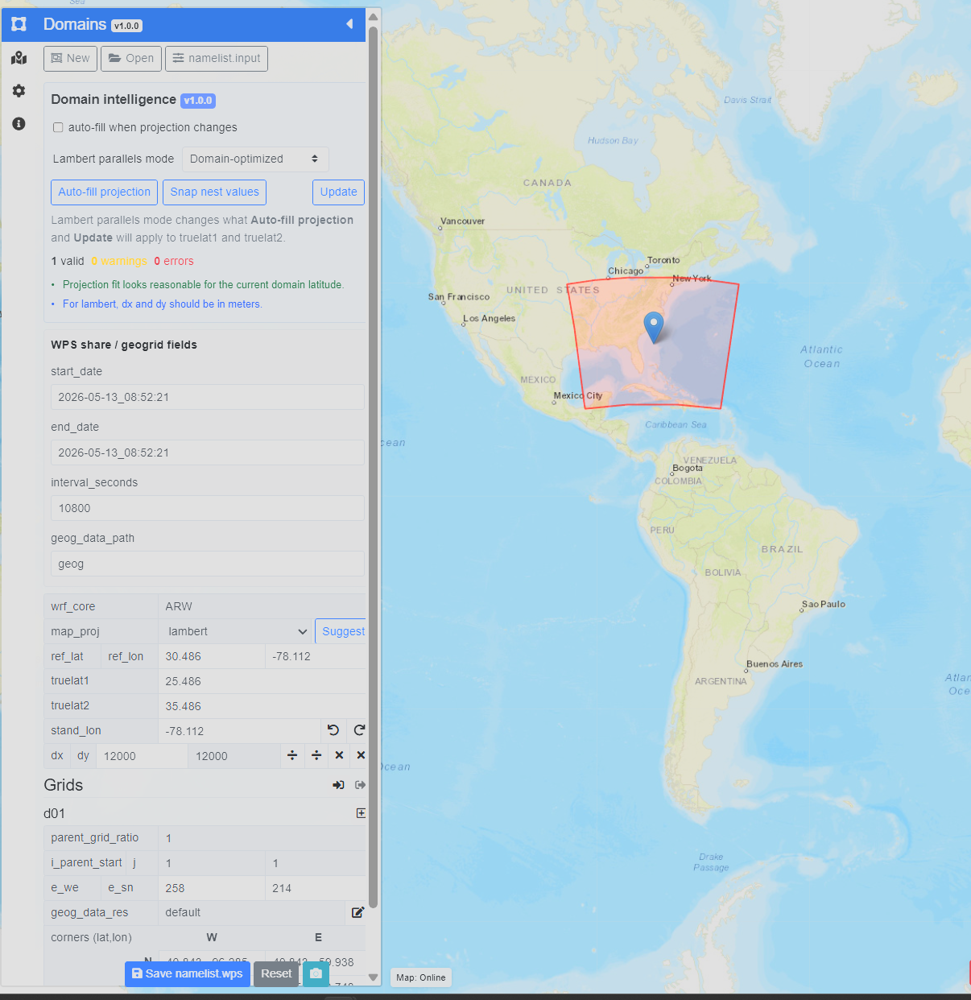

**Figure 4. Domain editing with WPS fields visible.** The map shows the active domain, and the sidebar shows WPS fields such as `start_date`, `end_date`, `interval_seconds`, `geog_data_path`, `map_proj`, `ref_lat`, `ref_lon`, `truelat1`, `truelat2`, `stand_lon`, `dx`, and `dy`.

The WPS section controls values exported to `namelist.wps`. These values should be checked before running `geogrid.exe`, `ungrib.exe`, or `metgrid.exe`.

---

## 7. Projection and Nest Examples

The map supports common WRF projection workflows, including Lambert conformal, Mercator, polar stereographic, and latitude-longitude configurations. The examples below show how the same UI can be used for different regions and projection choices.

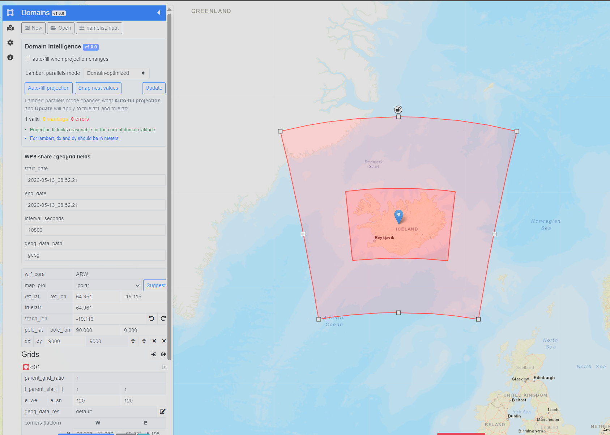

**Figure 5. Polar projection example with a nested domain.** The sidebar shows polar projection fields, and the map shows a parent domain with a nested grid over Iceland.

Nests are edited from the **Grids** section. Users should review `parent_grid_ratio`, `i_parent_start`, `j_parent_start`, `e_we`, `e_sn`, and `geog_data_res` before export. The application can help snap nest values, but users should still confirm that the nest placement makes sense for the forecast or research problem.

---

## 8. Full 360-Degree Map and Dateline Behavior

WRF Configuration Studio supports repeated-world map display and graticule behavior. This helps when users pan across the dateline or work near longitude wrap boundaries.

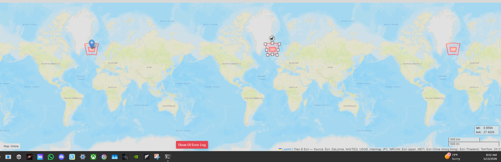

**Figure 6. Full 360-degree repeated-world map display.** The map can show repeated world copies while preserving canonical longitude values for export.

The visible map can repeat domains and graticules across world copies for editing convenience. This is display behavior only. Exported longitude values are normalized so users can review them in `namelist.wps`.

The map display is limited to approximately 85 degrees south to 85 degrees north because of Web Mercator display constraints. Users working near polar regions should inspect `namelist.wps` carefully and validate the domain through the official WPS tools.

---

## 9. Domain Size and Grid Warnings

WRF Configuration Studio includes visible warnings for selected structural issues, such as domains that are too small for typical WRF use.

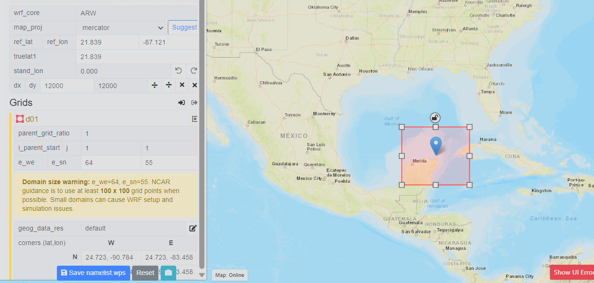

**Figure 7. Domain size warning in the Grids section.** The warning notes when `e_we` and `e_sn` are below commonly recommended minimum values.

Warnings are not the same as scientific validation. A warning should prompt the user to review the domain, grid spacing, nesting, and intended application before running WRF.

---

## 10. Settings Panel

The Settings panel controls map overlays and selected editor constraints.

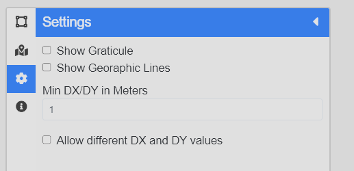

**Figure 8. Settings panel.** The Settings panel includes controls for graticule display, geographic lines, minimum DX/DY, and whether different DX and DY values are allowed.

The **Show Graticule** and **Show Geographic Lines** options control map overlays. The **Min DX/DY in Meters** field helps prevent accidental grid-spacing values that are too small for the intended workflow.

---

## 11. About, Credits, and Project Lineage

The About panel describes the current project, map behavior, lineage, credits, and original project references.

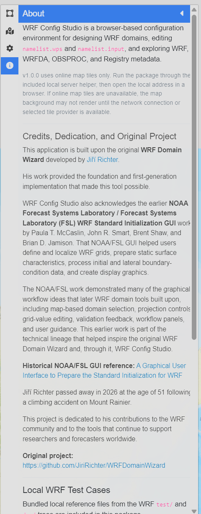

**Figure 9. About panel with project lineage and credits.** The About panel credits Jiří Richter and the original WRF Domain Wizard, acknowledges NOAA/FSL WRF Standard Initialization GUI work, and links to included references.

WRF Configuration Studio is built from the original WRF Domain Wizard lineage and acknowledges earlier NOAA/FSL graphical WRF configuration work. This lineage matters because map-based WRF configuration tools have a long history in the WRF community.

---

## 12. Full-Catalog `namelist.input` Editor

Press the **namelist.input** button in the Domains panel to open the full-catalog editor.

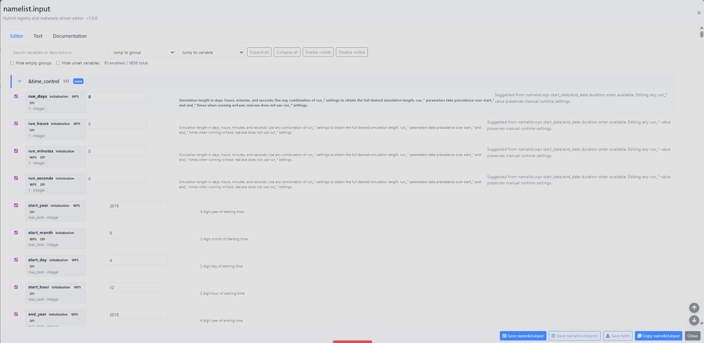

**Figure 10. Full-catalog `namelist.input` editor.** The Editor tab shows WRF groups, enabled fields, source labels, descriptions, values, and export controls.

The editor includes WRF core groups, WRFDA groups, OBSPROC record groups, Registry metadata, source notes, and documentation references. The current v1.0.0 policy is **everything visible**. The editor does not hide advanced variables, does not silently rewrite physics choices, and does not block export solely because compatibility metadata exists.

The top controls include:

- **Search variables or descriptions**,
- **Jump to group**,
- **Jump to variable**,
- **Expand all**,
- **Collapse all**,
- **Enable visible**,
- **Disable visible**,
- **Hide empty groups**, and
- **Hide unset variables**.

---

## 13. Jump to Group and Navigation

The editor can contain many groups and variables. The **Jump to group** menu is used to navigate quickly through the catalog.

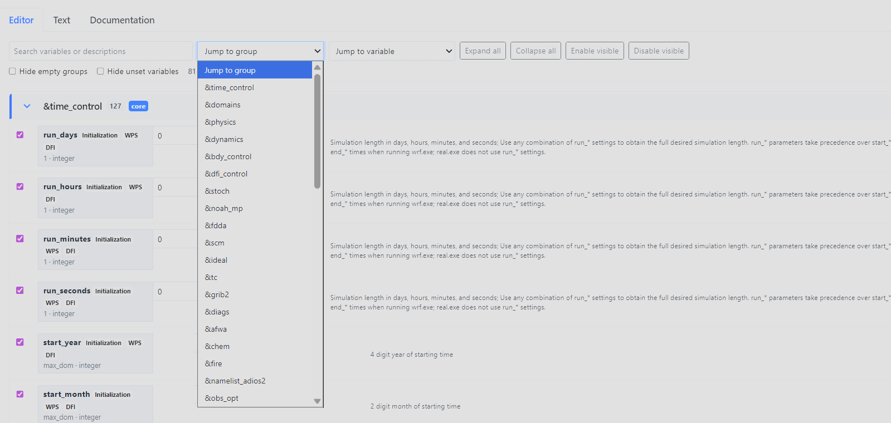

**Figure 11. Jump to group menu in the `namelist.input` editor.** The group selector provides quick access to WRF, WRFDA, physics, dynamics, diagnostics, chemistry, fire, and support groups.

Use the group and variable selectors when reviewing large configurations. This is especially useful when moving between `&time_control`, `&domains`, `&physics`, `&dynamics`, `&wrfda`, `&obs_opt`, and other specialized groups.

---

## 14. WRFDA and OBSPROC File Split

WRF Configuration Studio separates WRFDA and OBSPROC export behavior.

### WRFDA

WRFDA groups remain in:

```text
namelist.input
```

This includes `&wrfvar*` groups and related support groups such as `&obs_opt`, `&radar_da`, and `&perturbation` when enabled.

### OBSPROC

OBSPROC records are visible in the editor as:

```text
&obsproc_record1
&obsproc_record2
...
&obsproc_record9
```

During export, they are saved separately as:

```text
namelist.obsproc
```

and written as:

```text
&record1
&record2
...
&record9
```

This prevents OBSPROC records from being written into `namelist.input` while still allowing users to inspect related settings from one editor.

---

## 15. Save, Copy, and Export Controls

The WPS panel saves:

```text
namelist.wps
```

The `namelist.input` editor footer includes:

```text
Save namelist.input
Save namelist.obsproc
Save both
Copy namelist.input
Close
```

Use **Save namelist.input** for WRF and WRFDA configuration. Use **Save namelist.obsproc** for OBSPROC records. Use **Save both** when both files should be written from the same editor session.

The **Text** tab previews `namelist.input` only. OBSPROC records are exported separately through the `namelist.obsproc` save path.

---

## 16. Required-Field Warnings

If required `namelist.input` selections are blank, the editor warns before export. The user can cancel and return to the editor or continue intentionally.

This warning system is designed to prevent accidental incomplete exports while preserving user control. Some research or teaching workflows may require partial files, so WRF Configuration Studio warns rather than blocking every export.

---

## 17. Documentation Tab and Metadata

The Documentation tab gives users access to source material near the editor workflow. It includes links and reference panels for:

- WRF Users Guide namelist variables,
- WRF Registry files,
- `run/README.namelist`,
- WPS best practices,
- WRF best practices, and
- ARW Technical Note v4 scientific context, where available.

Select a variable in the Editor tab to review merged documentation, defaults, sources, and option metadata in the Documentation tab.

---

## 18. Recommended Workflow

A typical workflow is:

1. Open WRF Configuration Studio in online hosted mode or local package mode.
2. Open the Domains panel.
3. Draw or open a domain.
4. Choose the projection and grid settings.
5. Use Domain Intelligence helpers if needed.
6. Review `namelist.wps` fields.
7. Save `namelist.wps`.
8. Open the `namelist.input` editor.
9. Review `&time_control`, `&domains`, `&physics`, and other required groups.
10. Review WRFDA groups if data assimilation is part of the case.
11. Review OBSPROC records if observation processing is part of the case.
12. Save `namelist.input`, `namelist.obsproc`, or both.
13. Run the official WPS, WRF, WRFDA, or OBSPROC tools outside WRF Configuration Studio.
14. Review logs, model output, diagnostics, and verification results.

---

## 19. Troubleshooting

### The app does not load local JSON or catalogs

Do not open `index.html` directly with `file://`. Start a local HTTP server and open the `http://127.0.0.1` address.

### Port 8000 is already in use

Use the included launcher. It automatically selects the next available port and prints the correct URL.

### The map background is blank

WRF Configuration Studio v1.0.0 uses online map tiles only. Confirm that the computer has a network connection and that the browser can reach the selected tile provider.

### The map or UI looks old after replacing files

Use a hard refresh.

```text
Windows/Linux Chrome, Edge, Firefox: Ctrl+F5
macOS Chrome/Firefox: Cmd+Shift+R
macOS Safari: Option+Cmd+E, then reload
```

### A required-field warning appears

Review the listed fields. Cancel to return to the editor, fill the missing values, and export again. Choose continue only if a partial export is intentional.

### A domain size warning appears

Review `e_we`, `e_sn`, `dx`, `dy`, and the intended domain size. Small domains can cause WRF setup and simulation issues.

### Lambert values do not look right

Check the Lambert parallels mode, then press **Update**. Review `truelat1`, `truelat2`, `stand_lon`, `ref_lat`, and `ref_lon` before saving `namelist.wps`.

---

## 20. Known Limitations

WRF Configuration Studio v1.0.0 does not:

- download meteorological input data,
- run WPS,
- run WRF,
- run WRFDA,
- run OBSPROC,
- ingest emissions,
- run WRF-Chem,
- analyze NetCDF output,
- replace WRF logs,
- replace official documentation, or
- determine whether a configuration is scientifically valid.

The map is an editing and visualization surface. It is not a numerical proof of domain validity. Users should still inspect exported namelists and run the official WRF-family tools.

---

## 21. Credits

WRF Configuration Studio is built on the original WRF Domain Wizard developed by Jiří Richter.

The project also acknowledges earlier NOAA Forecast Systems Laboratory / Forecast Systems Laboratory WRF Standard Initialization GUI work by Paula T. McCaslin, John R. Smart, Brent Shaw, and Brian D. Jamison.

The v1.0.0 documentation also preserves project lineage, release history, technical references, and the historical NOAA/FSL GUI reference material.

---

## 22. Quick Reference: Export Files

| Workflow area | Exported file | Notes |
|---|---|---|
| WPS domain and preprocessing settings | `namelist.wps` | Saved from the Domains panel |
| WRF core configuration | `namelist.input` | Saved from the namelist editor |
| WRFDA groups | `namelist.input` | WRFDA remains inside `namelist.input` |
| OBSPROC records | `namelist.obsproc` | `obsproc_record*` groups export as `record*` groups |
| Registry and documentation metadata | not exported as model input | Used for reference and review |

---

## 23. Quick Reference: Online and Local Use

| Mode | Best for | Requirements | Map behavior |
|---|---|---|---|
| Online hosted mode | Website use, training, demonstrations, and quick review | Browser and network access | Online map tiles |
| Local package mode | Local package testing, classrooms, field laptops, and offline file access | Local HTTP server and browser | App files are local, but map tiles still require network access |

